 

  

## About Me
[ᴇɴ]
I am a Software Engineering student seeking opportunities in technology to develop my skills and gain hands-on experience.
I currently work as an intern at the CityHall of Nova Santa Rosa, Brazil, while pursuing my passion for technology and software development.

[ᴘᴛ-ʙʀ]
Sou estudante de Engenharia de Software e busco oportunidades na área de tecnologia para desenvolver minhas habilidades e adquirir experiência prática. Atualmente, trabalho como estágiaria na Prefeitura Municipal de Nova Santa Rosa, Brasil, enquanto sigo aprimorando meu desenvolvimento na tecnologia.

---

## Currently Learning

## Technologies & Tools

---

### Languages

---

<h2 align="left">Interests</h2>

  
   
  Building projects and learning new technologies.

  
   
  Creating intuitive and user-friendly experiences.

  
   
  Organizing tasks, requirements, and team workflows.

  
   
  Connecting user needs, business goals, and digital solutions.

<h3>
  Let's Connect
</h3>

  
  &nbsp;

